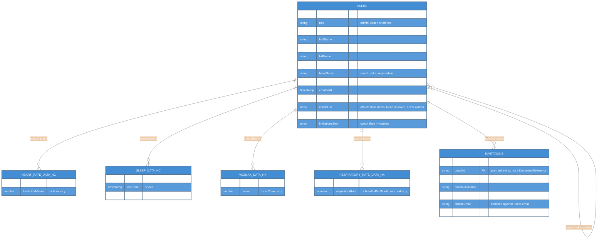

# Data Model

The Firestore shape the dashboard reads: `Users`, `Invitations`, and four per-athlete time-series subcollections with inconsistent field names.

---

## Overview

Everything lives in Cloud Firestore. The dashboard does not define this schema; the companion smart-clothing mobile app writes it (see [[02-SystemContext]]), so the shape below is *observed*, not enforced. That one fact explains most of the API's design: it normalizes on read because it cannot fix data at the source.

**Health subcollections are never client-writable**, by any role. Any seed or backfill runs server-side with `firebase-admin`.

---

## Collections

The same ER diagram, with the palette, is in [[06-Code]]. The repo `README.md` carries a duplicate.



### Legend

- Each box is a collection or subcollection; field comments list the alternative spellings the API accepts.
- `PK` / `FK` are conventions only.

The crow's feet are conventions, not constraints — Firestore has no joins, no foreign-key integrity
and no cascades. Literal paths, since documents are addressed by path:

```
Users/{uid}
Users/{uid}/HeartRateDataHC/{docId}          Users/{uid}/VO2MaxDataHX/{docId}
Users/{uid}/SleepDataHC/{docId}              Users/{uid}/RespiratoryRateDataHX/{docId}
Invitations/{invitationId}
```

`src/pages/Register.jsx` is the closest thing to a schema definition: it is the only place that
creates a `Users` document from scratch, writing `firstName`, `lastName`, `fullName`, `email`,
`role` (**hard-coded to `"coach"`**), `institution`, `teamName`, `invitationsSent: []` and
`createdAt`. Note what it does *not* write: `sports`, `authorizedAthletes`, `coachList` and
`pendingPermissions` are all created lazily by later `arrayUnion` calls, so absent-versus-empty is a
real distinction on those fields. `institution` and `teamName` are written and never read.

The `HC` / `HX` suffixes evidently distinguish data sources. **`HX` is Hexoskin** — `server/server.js`
comments the VO₂ route "VO2 max (Hexoskin)" and `Vo2MaxChart.jsx` labels its tooltip the same way.
**`HC` is not explained anywhere in this repository**; the obvious guess is Health Connect, but
nothing here confirms it, so treat it as unverified until someone who worked on the mobile app says
otherwise.

Respiratory rate lives in `RespiratoryRateDataHX` and is read only by the team endpoint — there is no
per-athlete respiratory route.

---

## `authorizedAthletes` Is References, Not Ids

This is the single most surprising thing in the model. `Users/{coachUid}.authorizedAthletes` is an
array of **Firestore `DocumentReference` objects** pointing at `Users/{athleteUid}` — not an array of
uid strings.

The API therefore does:

```js
for (const athleteRef of authorizedAthletes) {
  const athleteDoc = await athleteRef.get();      // works because it IS a ref
  const userRecord = await admin.auth().getUser(athleteDoc.id);
  // ...
}
```

Two consequences:

- Writing to this array from the client requires constructing a real `doc()` reference, not a string.
- The read is **N+1 by construction** — one Firestore `get()` plus one Auth `getUser()` per athlete,
  serially. Fine for a roster of a dozen; not fine for a few hundred. See [[Known_Issues]].

`Invitations.coachId` is the exception to the reference convention: a plain uid string, which is why
`fetchPendingInvitations` finds them with `where("coachId", "==", coachId)` rather than a reference
lookup.

## Nothing in This Repo Writes `authorizedAthletes`

Verified 2026-09-03 by grepping every write path, and still true on `refactor @ 99a9eb6`. `authorizedAthletes` and `coachList` are **read but
never written** anywhere in `src/`, `server/` or `email-service/`.

What the invitation flow in `src/features/invitations/api/sendInvitation.js` actually does:

1. looks up the athlete by `where("email", "==", athleteEmail)`,
2. bails if the coach is already in the athlete's `coachList`,
3. creates `Invitations/{id}` with `status: "pending"`,
4. `arrayUnion`s that invitation ref into the coach's `invitationsSent`,
5. `arrayUnion`s the coach ref into the athlete's `pendingPermissions`.

Nothing promotes a `pendingPermissions` entry into the coach's `authorizedAthletes` or the athlete's
`coachList` — there is no accept or approve path in this codebase. `src/pages/AthleteAccess.jsx`,
which looks like it would be that screen, renders **mock data** from
`src/features/athlete-access/data/athletes.js`, and its Cancel / Revoke / Save buttons have no `onClick`.

**Verified live on 2026-09-05:** existing coaches *do* have populated rosters. The project holds 150
users (111 athletes, 39 coaches), and a test coach returned a full athlete list, so **something outside
this repo writes the array**. That downgrades the problem from "no coach ever sees data" to "a newly
registered coach starts with an empty roster and no error". Which system does the writing is an open
question for the previous team (see [[Standup/README|Standup]]). Tracked in [[Known_Issues]] #9.

---

## Names Come From Firebase Auth, Not Firestore

A user's display name is not reliably in the Firestore document. `/api/getUsers` calls
`admin.auth().getUser(uid)` and splits `displayName` on the first space into `firstName` / `lastName`.

The team endpoints use `getAthleteLabel(userId)`, which tries in order:

1. Firebase Auth `displayName`
2. Firestore `firstName + lastName`
3. the raw uid

`/api/team/heart-rate` has its own inline version of this that falls back to `displayName || email || uid`
— slightly different, because it predates the shared helper. See [[API_Endpoints]].

A name split on a single space obviously mangles "Maria del Carmen Ruiz". Nothing depends on the
split being correct today, but nothing guards against it either.

---

## Time-Series Documents Have Inconsistent Field Names

This is the core reason the API exists at all. The same logical field is spelled differently
depending on which source wrote the document, so every route funnels through a per-metric mapper.

| Metric | Subcollection | Timestamp field, in the order tried | Value field, in the order tried |
| --- | --- | --- | --- |
| Heart rate | `HeartRateDataHC` | `time` → `timestamp` → `x` | `beatsPerMinute` → `bpm` → `y` |
| Sleep | `SleepDataHC` | `startTime` → `start`, and `endTime` → `end` | `stage` → `sleepStage` → `phase` |
| VO₂ max | `VO2MaxDataHX` | `timestamp` | `value` → `vo2max` → `y` |
| Respiratory rate | `RespiratoryRateDataHX` | `time` → `timestamp` → `date` → `x` | `respiratoryRate` → `breathsPerMinute` → `rate` → `value` → `y` |

Adding a metric means adding a row to this table and a `pickRows` mapper — not changing a schema.

---

## Timestamps Arrive in Four Different Types

`toDate(v)` in `server/server.js` accepts all of these and returns a JS `Date` or `null`:

| Input | Where it comes from |
| --- | --- |
| `admin.firestore.Timestamp` | a proper Firestore write |
| `{ _seconds: 1699... }` | a serialized Timestamp that lost its prototype |
| `1699999999999` (number) | epoch milliseconds |
| `"2026-09-03T10:00:00Z"` (string) | an ISO string written as text |

Anything else — or an unparseable string — yields `null`, and `clampAndSort` drops the row silently.
**A chart that renders fewer points than you expect is usually this**, not a query bug. There is no
logging when a row is discarded.

---

## Sleep Is Intervals, Not Points

Sleep documents describe a span (`start`, `end`, `stage`), not an instant. The routes handle this
specially: a sleep interval is kept if it **intersects** the requested window, rather than being
required to fall inside it. Sorting still uses the start time.

`stage` is coerced with `Number(stage)`. The encoding is defined by the upstream writer, and
`src/features/athlete-health/components/SleepTimeline.jsx` is the one place in this repo that spells it out:

| `stage` | Meaning |
| --- | --- |
| 1 | Awake |
| 2 | REM |
| 3 | Light |
| 4 | Deep |

Note the ordinal runs the opposite way from sleep depth, so `SleepTimeline` remaps it for plotting
(`STAGE_TO_Y = { 1: 3, 2: 2, 3: 1, 4: 0 }`) to put Deep at the bottom of the chart. (A second,
conflicting five-label set lived in `SleepGraph.jsx`, which Phase 1 deleted as an orphan.)

## Live Data Facts (2026-09-05)

Probed against the running API; these supersede earlier guesses.

- Real health data exists: one athlete returned 529 heart-rate points, 28 sleep records and 12 VO₂ max readings.
- **It is all stale.** The newest sample anywhere is 2025-03-27. To see data, set a range of 2025-03-26 → 2025-03-28.
- `RespiratoryRateDataHX` returned 0 points for the same athlete. See [[API_Endpoints]].
- The frontend web config and the server's service account must belong to the **same** project (`coach-student-invite`). A `smart-clothing-app` key fails as "Coach not found", because the uids belong to a different Auth tenant.

---

## Security Rules

`firestore.rules` at the repo root is permissive prototype configuration: any authenticated user may
read and write any document, including every athlete's health subcollections and their own `role`.
It also holds a leftover date-limited rule from an earlier app that expired on 2025-08-24. There is no
`firebase.json` or `.firebaserc`, so nothing in the repo can deploy, validate or emulator-test the
rules, and the live rules may not be this file. Planned fix: [[SEC_2_Firestore_Rules]].

---

## Key Files

| File | Purpose |
|------|---------|
| `server/server.js` | `toDate`, `clampAndSort`, the `pickRows` mappers, `getAthleteLabel` |
| `src/pages/Register.jsx` | The only creator of `Users/{uid}` |
| `src/features/invitations/api/sendInvitation.js` | Writes `Invitations`, `invitationsSent`, `pendingPermissions` |
| `src/features/invitations/api/fetchPendingInvitations.js` | `where("coachId", "==", …)` |
| `firestore.rules` | Prototype rules |

---

## Related Notes

- [[06-Code]]
- [[API_Endpoints]]
- [[Auth_And_Roles]]
- [[05-Component-API]]
- [[Known_Issues]]
