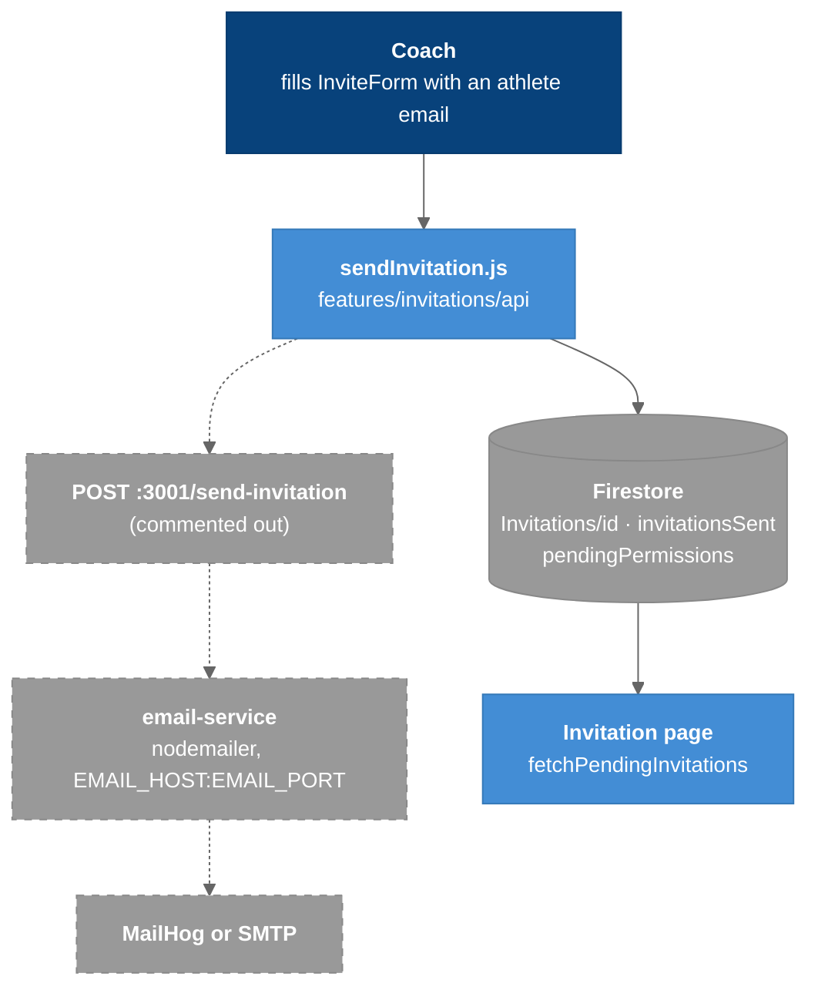

# Email Service

The third deployable: a 46-line Express + nodemailer app that turns an invitation request into an email. It runs, and nothing calls it.

---

## Overview

`email-service/server.js`, port **3001**, one route. It was built to send an athlete an invitation email when a coach invites them. The frontend call to it has been **commented out since before the refactor** (it was already a comment in the version Phase 1 cleaned up), so today an invitation writes Firestore records and sends no email. `npm run dev:all` still starts the service, and it answers on :3001.

The old vault note described the POST as live. It was not, even then.

---

## The Invitation Flow Today



### Legend

- **Solid** = runs today
- **Gray, dashed** = exists but is not reached: the call is commented out in `sendInvitation.js`

`sendInvitation.js` looks the athlete up by email, bails if the coach is already in their `coachList`, creates `Invitations/{id}` with `status: "pending"`, and `arrayUnion`s references into the coach's `invitationsSent` and the athlete's `pendingPermissions`. Nothing accepts an invitation. See [[Data_Model]].

`Invitation.jsx` fetches pending invitations and passes them to `PendingInvitations`, which **ignores the prop** and renders a static heading. The invitations feature has data flowing to nothing.

---

## The One Endpoint

```
POST /send-invitation
body: { athleteEmail, coachName, institution }
200: "Invitation sent successfully."
500: "Error sending invitation."
```

Plain-text bodies, not JSON. CORS is wide open (`app.use(cors())`), unlike the Insights API's allowlist. The port is **hard-coded to 3001**; there is no `PORT` override.

## Transport Configuration

```js
nodemailer.createTransport({
  host: process.env.EMAIL_HOST,
  port: process.env.EMAIL_PORT,
  secure: false,      // MailHog does not use SSL
  auth: null,
});
```

This targets a local [MailHog](https://github.com/mailhog/MailHog) on `localhost:1025`, which accepts anything and delivers nothing. A real provider needs `secure: true`, a real port and credentials, none of which the code reads. The `from` address (`noreply@coachingdashboardtest.com`) is hard-coded and not a domain the project controls.

**No invitation email has ever left this system.**

## Dependencies

`nodemailer` was undeclared until refactor Phase 1, which added it to `package.json`. The service now starts after a clean `npm install`.

## Not Deployed

Netlify hosts the frontend and Render hosts the Insights API; nothing hosts this. See [[Deployment]].

---

## Key Files

| File | Purpose |
|------|---------|
| `email-service/server.js` | The service |
| `src/features/invitations/api/sendInvitation.js` | Firestore writes; the commented-out POST |
| `src/features/invitations/api/fetchPendingInvitations.js` | Reads `Invitations` by `coachId` |
| `src/features/invitations/components/InviteForm.jsx`, `PendingInvitations.jsx` | UI |
| `src/pages/Invitation.jsx` | `/invitation` |

## Tests

None.

---

## Related Notes

- [[03-Container]]
- [[07-Dynamic-Diagrams]]
- [[Configuration]]
- [[Data_Model]]
