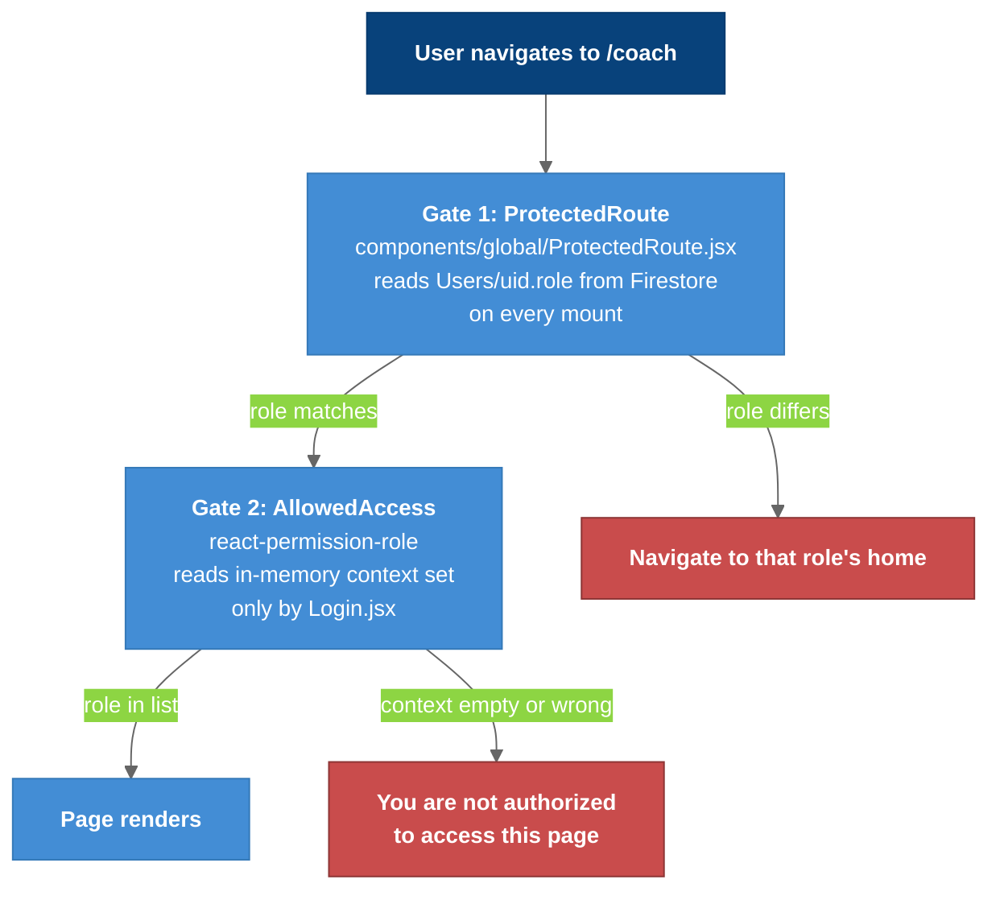

# Auth and Roles

Three roles (`admin`, `coach`, `athlete`) stored as `Users/{uid}.role` in Firestore, enforced by two independent gates in the browser and by nothing on the server.

---

## Overview

There is no custom-claims setup; the role is an ordinary document field. Every protected page passes through **two separate mechanisms that do not know about each other**. A role change therefore usually needs edits in both places, and a bug in either produces confusingly different symptoms.

The roles are a **UI concern only**. The API verifies no token (see [[#Server-Side Authorization]]).

---

## Two Independent Gates



### Legend

- **Dark blue** = the user
- **Blue** = the gates and the happy path
- **Red** = the two ways out; the red box on the right is the refresh bug

### Gate 1: `ProtectedRoute`

`src/components/global/ProtectedRoute.jsx` wraps every route in `App.jsx` except `/` and `/register`. On mount it:

1. waits for `useAuthState(getAuth())`, and sends a signed-out user to `/`,
2. reads `Users/{uid}` from Firestore directly with the Web SDK,
3. compares `userData.role` against the route's `requiredRole`,
4. on mismatch, redirects to that role's home: `admin → /admin`, `coach → /coach`, `athlete → /athlete`, falling back to `/`.

It is **durable across refreshes** because it re-reads Firestore every time. It costs one Firestore read per navigation and renders `Loading...` / `Loading role...` while that read is in flight.

### Gate 2: `<AllowedAccess>`

Pages additionally wrap their content in `<AllowedAccess roles={["coach"]} renderAuthFailed={...}>` from `react-permission-role`. That library reads an **in-memory context**, and that context is populated in exactly one place:

```js
// src/pages/Login.jsx
setUser({ id: ..., roles: [userData.role] });
```

Nothing else ever calls `setUser`. So:

- **A hard refresh empties it.** `PermissionProvider` state does not survive a reload, and nothing rehydrates it from Firebase Auth on boot.
- The user still passes Gate 1 (which re-reads Firestore), reaches the page, and then sees "You are not authorized to access this page." from Gate 2.

The fix is to populate the permission context from the same `onAuthStateChanged` path `ProtectedRoute` already uses. Tracked in [[Known_Issues]] #7.

---

## Which Pages Use Which

| Page | Route | `ProtectedRoute` | `<AllowedAccess>` |
|------|-------|------------------|-------------------|
| `Admin` | `/admin` | admin | yes |
| `CoachDashboard` | `/coach` | coach | yes |
| `AthleteAccess` | `/athlete-access` | coach | yes |
| `Settings` + 5 sub-pages | `/settings`, `/settings/{profile,team,notifications,dashboard,appearance}` | coach | yes |
| `TeamInsights` | `/team-insights` | coach | no |
| `AthleteInfo` | `/info` | coach | no |
| `Invitation` | `/invitation` | coach | no |
| `AthleteDashboard` | `/athlete` | athlete | no |

The inconsistency is worth knowing: `TeamInsights`, `AthleteInfo` and `Invitation` are protected by the route gate only, so they keep working after a refresh where `CoachDashboard` does not.

---

## Changing a Role

Two paths can write `Users/{uid}.role`:

- `POST /api/updateRole` with `{ email, newRole }` → `admin.auth().getUserByEmail()` → `set({ role }, { merge: true })`. **Nothing in the UI calls it any more.** The Admin page's "promote to coach" form was removed at some point, and Phase 6 deleted the orphaned handler it left behind.
- Editing the document by hand in the Firebase console.

Either way the change takes effect on the user's **next navigation** (Gate 1 re-reads), but their in-memory permission context keeps the old role until they sign in again.

## Registration and Missing Roles

`src/pages/Register.jsx` creates `Users/{uid}` with `role` **hard-coded to `"coach"`**, so the form can only create coaches. An Auth account with no `Users/{uid}` document at all (the `matthew@gmail.com` test account is one) authenticates, then sits on `Loading role...` forever.

`Login.jsx` navigates to `/home` in its fallback branches, and no `/home` route exists, so a user with a missing or unrecognized role gets a blank page.

`Login.jsx:53-55` and `ProtectedRoute.jsx:21` also `console.log` the full user document and role on every login and guarded navigation, in production. See [[Known_Issues]] #3.

---

## Server-Side Authorization

There isn't any. `server/server.js` verifies **no** Firebase ID token. The time-series routes take a `userId` query parameter and return that athlete's data to anyone who can reach the API. CORS is a browser convention, not an access control. `/api/getUsers` with no `coachId` returns every user in the project.

The planned fix is [[SEC_1_API_Auth_Tokens]] (API) together with [[SEC_2_Firestore_Rules]] (client path). Both are required; neither is sufficient alone, because the API's service account bypasses Firestore rules.

---

## Key Files

| File | Purpose |
|------|---------|
| `src/components/global/ProtectedRoute.jsx` | Gate 1: Firestore role read and redirect |
| `src/pages/Login.jsx` | Sign-in; the only `setUser` call (Gate 2) |
| `src/pages/Register.jsx` | Creates `Users/{uid}` with `role: "coach"` |
| `src/App.jsx` | `PermissionProvider` and the route table |
| `firestore.rules` | Prototype rules: any signed-in user can read and write anything |

## Tests

| File | Tests | Description |
|------|-------|-------------|
| `src/__tests__/routes.test.jsx` | 1 | Login + role redirect against live Firebase (credential is dead) |

---

## Related Notes

- [[04-Component-Frontend]]
- [[07-Dynamic-Diagrams]]
- [[Data_Model]]
- [[API_Endpoints]]
- [[Known_Issues]]
