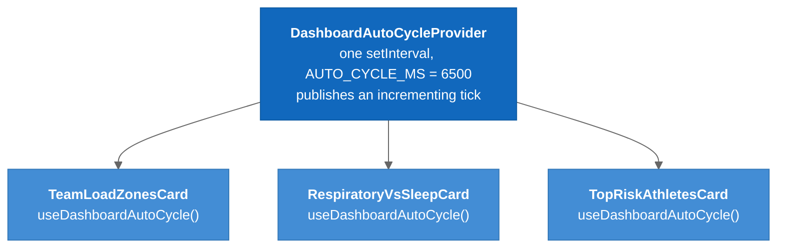

# Coach Dashboard

The coach's landing page at `/coach`: a presentational card grid over mock data, kept in sync by one shared 6.5s tick.

---

## Overview

`src/pages/CoachDashboard.jsx` plus `src/features/coach-dashboard/`. The most visually developed part of the app, and **not connected to the API**. It is a design surface: a worked-out picture of what the dashboard should show, with the data layer still to come. Do not debug why a number "looks wrong"; it is a literal from a mock module.

Wiring these cards to the API is the largest outstanding piece of product work. [[Team_Insights]] shows what a live version looks like.

---

## The Cards

Since refactor Phase 4 every card's mock content lives in `features/coach-dashboard/data/`, and most cards take it as a **prop defaulting to the module**. `CoachDashboard.jsx` passes nothing today, so the seam exists without changing behaviour. A real API only has to pass props.

| Card | Component | Data module | Chart library |
|------|-----------|-------------|---------------|
| Header (coach name, date) | `CoachDashboardHeader.jsx` | `coach.js` | — |
| KPI row | `DashboardKpisRow.jsx` | `kpis.js` | — |
| Mini team builder | `MiniTeamBuilderCard.jsx` | `roster.js` | — (drag-and-drop, sport surfaces) |
| Respiratory vs. sleep | `RespiratoryVsSleepCard.jsx` | `respiratoryVsSleep.js` | — |
| Team load zones | `TeamLoadZonesCard.jsx` | `loadZones.js` (**no prop seam**; imported directly) | Recharts |
| Team sleep duration | `TeamSleepDurationCard.jsx` | `sleepDuration.js` | Recharts |
| Team VO₂ trend | `TeamVo2TrendCard.jsx` | `vo2Trend.js` | Recharts |
| Recent activity | `RecentActivityCard.jsx` | `recentActivity.js` | — |
| Athletes to check on | `AthletesToCheckOnCard.jsx` | `athletesToCheckOn.js` | — |
| Top risk athletes | `TopRiskAthletesCard.jsx` | `riskAthletes.js` | — |
| Team injury risk | `TeamInjuryRisk.jsx` | `injuryRisk.js` | Recharts |
| Team recovery | `TeamRecoveryCard.jsx` | `recovery.js` | — |

`components/ui/DashboardCard.jsx` is the shared shell; `components/ui/SyncedSegmentedToggle.jsx` is the tab control the multi-view cards use. `DashboardKpisRow` and `TeamInjuryRisk` still duplicate the card chrome instead of rendering `<DashboardCard>`; since Phase 8D all three share `DASHBOARD_CARD_BASE`, so the values cannot drift.

`TeamLoadZonesCard` got no prop seam because its datasets are consumed inside five nested module-scope helpers. A partial seam would update the charts but not the summary panel beside them.

---

## The Synchronized Auto-Cycle

`features/coach-dashboard/context/DashboardAutoCycleContext.jsx` is the piece worth understanding before touching a card.

**The problem it solves:** several cards show more than one view. If each ran its own timer they would drift apart within a minute and the dashboard would look like noise.

**The solution:** one provider, one `setInterval`, one shared tick.



### Legend

- **Dark blue** = the single provider (one timer for the whole page)
- **Blue** = the three cards that subscribe

`CoachDashboard.jsx` mounts the provider inside `<AllowedAccess>`. A card that calls `useDashboardAutoCycle` outside the provider **throws by design**.

### Two behaviours

| Views | Behaviour | What happens on each tick |
|-------|-----------|---------------------------|
| 3 or more | `cycle` | Advance to the next view and stay there. The content itself is the motion. |
| exactly 2 | `tease` | Alternate: odd ticks nudge the toggle pill only; even ticks flip to the other view for `TEASE_DURATION_MS` (800ms) and snap back. |

The tease exists because a two-view card that flipped every 6.5s would be annoying to read. Instead it mostly holds still and briefly *hints* that another view exists:

```
 6.5s  toggle nudge (pill animates, content unchanged)
13.0s  content teases for 800ms, then returns
19.5s  toggle nudge
26.0s  content teases
```

### Three ways a card stops moving

| Trigger | Scope | Duration |
|---------|-------|----------|
| Mouse enters the card | that card only | while hovering |
| User clicks a toggle tab | that card only | **until page refresh**: `clickedLockedRef` is never cleared |
| Provider unmounts | all | — |

Once a coach has expressed a preference by clicking, the dashboard stops second-guessing them. It is easy to mistake for a bug ("the card stopped rotating").

### Return value

```js
const {
  view,                 // what to render right now (may be a temporary tease view)
  setManualView,        // call from the toggle; locks the card
  handleMouseEnter,     // wire to the card root
  handleMouseLeave,
  nudgePulse,           // increments to drive SyncedSegmentedToggle's pill animation
  activeIndex,          // index of `view`
  restingIndex,         // index of the view it will return to
  viewCount,
} = useDashboardAutoCycle({ views, defaultView, behavior = "auto", teaseView = null });
```

`activeIndex` vs `restingIndex` matters for the toggle: during a tease the content has moved but the *resting* selection has not, and the pill should reflect the resting state.

The file carries a disabled "click nudge" feature (pulse a locked card's toggle every 5s after 60s). If it is enabled, `clearClickNudgeTimers` must be added to the unmount effect.

---

## Layout

The card grid is **two columns at every width** and overflows visibly below ~900px. This was true before the refactor: the old stylesheet's responsive rules were declared *before* an unconditional two-column rule and never applied. Phase 8B converted the grid faithfully rather than fixing it, because making it collapse is a design decision. See [[Known_Issues]] #17 and [[Refactor_Phase_8B_Dashboard_Shell]].

## Known Defects in the Mock Data

- The team builder's roster tabs filter on `athlete.group`, which no roster row has; every tab but "All Athletes" is empty.
- Two divergent 4-3-3 coordinate sets exist in `MiniTeamBuilderCard.jsx`.
- The KPI row says 12 athletes; the builder roster holds 18.
- Some load-zone and VO₂ values look derived but are frozen strings; flagged in their data modules.

---

## Key Files

| File | Purpose |
|------|---------|
| `src/pages/CoachDashboard.jsx` | Page shell, card grid, coach panel |
| `src/features/coach-dashboard/components/*` | 12 cards + header |
| `src/features/coach-dashboard/components/teamBuilderClasses.js` | Runtime-variant class lookup (avatars, sport surfaces, badges) |
| `src/features/coach-dashboard/context/DashboardAutoCycleContext.jsx` | Shared tick, `useDashboardAutoCycle` |
| `src/features/coach-dashboard/data/*` | 12 mock data modules |
| `src/components/ui/DashboardCard.jsx` | Card shell, `DASHBOARD_CARD_BASE` |

## Tests

None. `useDashboardAutoCycle`'s tick and tease state machine is a good first unit test. See [[Testing]].

---

## Related Notes

- [[Styling_And_Charts]]
- [[04-Component-Frontend]]
- [[Frontend_Data_Flow]]
- [[Known_Issues]]
