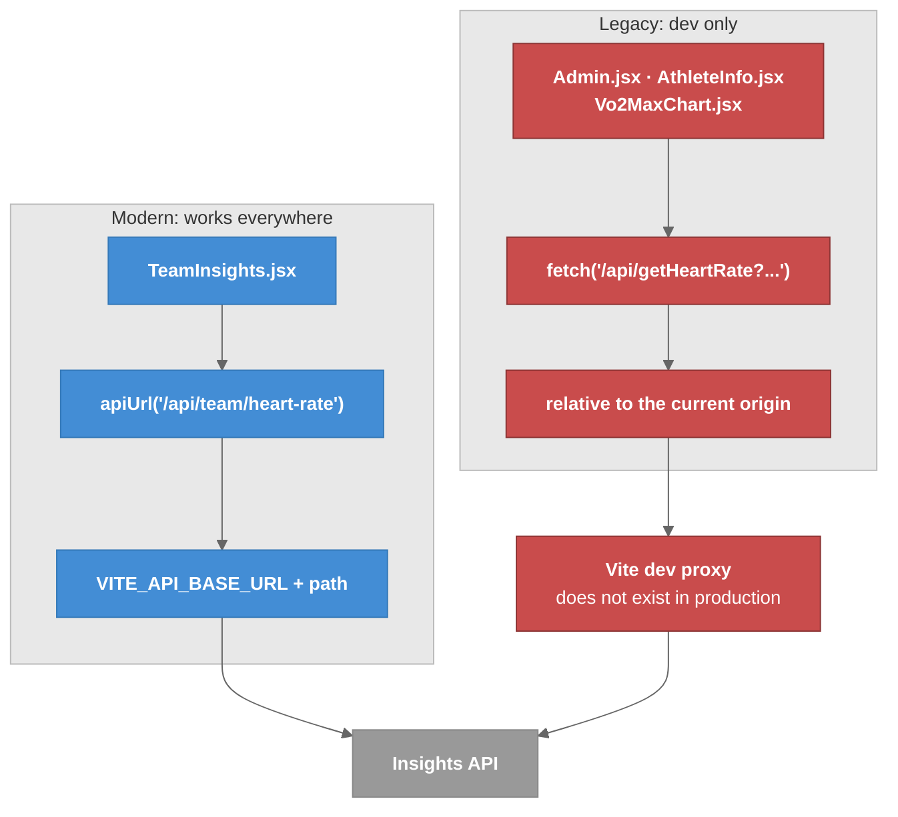

# Frontend Data Flow

How the SPA gets data, and the one convention split that decides whether a page works in production.

---

## Overview

The SPA reaches data two ways: the **Firebase Web SDK** directly (auth, role lookup, invitations) and the **Insights API** over HTTP (every health metric). The API calls are written in two styles, and only one of them works once deployed. There is no state library; each page does its own `useEffect` + `fetch` + `useState`.

---

## Two Conventions, One Broken in Production



### Legend

- **Blue** = the path that works on Netlify
- **Red** = the path that only works through the Vite dev proxy
- **Gray** = the API container

| Convention | Files | Dev | Deployed |
|------------|-------|-----|----------|
| `apiUrl()` from `src/lib/apiBase.js` | `src/pages/TeamInsights.jsx` | works | **works** |
| Bare `/api/...` paths | `src/pages/Admin.jsx`, `src/pages/AthleteInfo.jsx` | works | **fails** |
| Bare legacy path via `axios` | `src/features/athlete-health/components/Vo2MaxChart.jsx` (`/getVO2MaxData`) | works | **fails** |

`apiBase.js`:

```js
const rawBaseUrl = import.meta.env.VITE_API_BASE_URL || "";
export const API_BASE_URL = rawBaseUrl.replace(/\/$/, "");
export function apiUrl(path) {
  const cleanPath = path.startsWith("/") ? path : `/${path}`;
  return `${API_BASE_URL}${cleanPath}`;
}
```

With `VITE_API_BASE_URL` empty it returns the path unchanged, which is exactly right in dev where the Vite proxy handles it. That is why both conventions look identical locally, and why the split is invisible until deploy.

**New code uses `apiUrl()`.** Migrating the rest is tracked in [[Known_Issues]] #6.

---

## The Dev Proxy

`vite.config.js`:

```js
server: {
  port: 5173,
  proxy: {
    "/api": { target: "http://localhost:3000", changeOrigin: true },
    "/getVO2MaxData": { target: "http://localhost:3000", changeOrigin: true },
  },
}
```

Note the deliberate absence of a `rewrite`. An earlier version stripped the `/api` prefix, which turned `/api/getHeartRate` into `/getHeartRate` on the server and 404'd. The commented-out line in `vite.config.js` is that mistake, preserved. Keep the prefix.

`/getVO2MaxData` gets its own entry because that one legacy route was never given an `/api` prefix.

---

## The Date-Range Contract

Date pickers produce `YYYY-MM-DD`; the API expects ISO instants. `src/lib/dates.js` bridges them:

| Helper | Does |
|--------|------|
| `toISOAtStartOfDay("2026-09-03")` | `"2026-09-03T00:00:00.000Z"` |
| `toISOAtEndOfDay("2026-09-03")` | `"2026-09-03T23:59:59.999Z"` |
| `isValidDateOrder(start, end)` | both parse and `start <= end` |
| `windowFromSingleDay(day)` | `[startISO, endISO]` for a one-day query |
| `debounce(fn, wait)` | trailing-edge debounce, for picker churn |

**These are UTC day boundaries, not local ones.** A coach in Los Angeles asking for "September 3rd" gets 00:00–23:59 UTC, which is 5pm Sep 2 to 4:59pm Sep 3 local. For sleep data that is the wrong window. Nothing in the app corrects for it.

**The data is also stale.** The newest sample in the project is 2025-03-27, so any recent window renders blank. Use 2025-03-26 → 2025-03-28 to see real data. See [[Known_Issues]] #11.

---

## Where Charts Get Their Data

| Page | Source | Live data? |
|------|--------|------------|
| `TeamInsights` | `/api/getUsers`, `/api/team/*` through `apiUrl()` | yes |
| `AthleteInfo` | `/api/getHeartRate`, `/api/getSleepData`, `/getVO2MaxData` (bare paths) | yes, dev only |
| `Admin` | `/api/getUsers` (bare path) | yes, dev only |
| `CoachDashboard` | mock modules in `features/coach-dashboard/data/` | **no** |
| `AthleteDashboard` | thin | mostly no |

**Only `/coach` is genuinely hardcoded.** `/team-insights` and `/info` fetch real data; they just have nothing to show in a recent window. Do not "fix" them as mock pages. See [[Coach_Dashboard]] and [[Team_Insights]].

## Failures Look Like Empty Data

`TeamInsights.jsx:79-81` catches every `/api/getUsers` failure and calls `setAthletes([])`. A 500, a dead API, a quota error and a genuinely empty roster all render identically. The series fetches and `AthleteInfo` behave the same way. On 2026-09-07 this hid a Firestore quota outage long enough for it to be suspected as a CSS regression. Check the console and network tab before assuming there is no data.

## State Management

There is none, beyond React's own. Each page hand-rolls `useEffect` + `fetch`, with no caching or request deduplication. Navigating away and back re-fetches everything, and every Team Insights toggle re-reads each athlete's full history. That multiplies the unbounded-read problem in [[API_Endpoints]].

---

## Key Files

| File | Purpose |
|------|---------|
| `src/lib/apiBase.js` | `apiUrl()` |
| `src/lib/dates.js` | ISO start/end-of-day helpers, `debounce` |
| `src/lib/firebase.js` | The only `initializeApp()`; exports `auth`, `db` |
| `vite.config.js` | Dev proxy |

---

## Related Notes

- [[03-Container]]
- [[API_Endpoints]]
- [[Team_Insights]]
- [[Configuration]]
- [[Deployment]]
