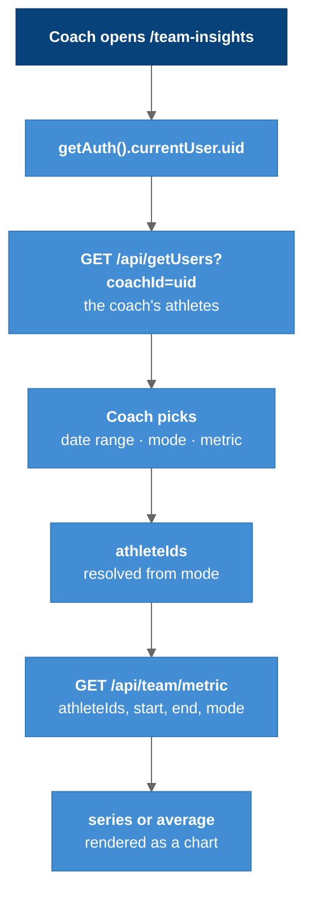

# Team Insights

`/team-insights` for coaches: multi-athlete health charts over a date range. The one page that reads live data through the deployed API, and the reference for how new data-driven pages should be written.

---

## Overview

`src/pages/TeamInsights.jsx` plus `src/features/team-insights/components/`. It is the only page that calls `apiUrl()` from `src/lib/apiBase.js`, which makes it the only page that works against the deployed API rather than only through the Vite dev proxy. See [[Frontend_Data_Flow]].

Copy its shape when adding a page:

```js
const res = await fetch(apiUrl(`/api/getUsers?coachId=${encodeURIComponent(coachId)}`));
if (!res.ok) throw new Error(`getUsers failed: ${res.status}`);
```

Note the `res.ok` check and the `encodeURIComponent`, both absent from the older pages. Do **not** copy its error handling (see [[#Response Handling]]).

---

## The Flow



### Legend

- **Dark blue** = the coach's action
- **Blue** = page logic and API calls, in order

The same flow as a sequence diagram is in [[07-Dynamic-Diagrams]].

---

## Controls

### Mode

| Mode | `athleteIds` sent | Renders |
|------|-------------------|---------|
| `team-overlay` | every athlete on the roster | all series on one chart |
| `team-grid` | every athlete | one card per athlete |
| `team-avg` | every athlete | the single averaged series (`mode=avg`) |
| `compare` | only the manually selected athletes | selected series on one chart |

The athlete multi-select only affects `compare`; the three `team-*` modes always send the full roster.

### Metric

`heart-rate`, `sleep`, `vo2max`, `respiratory-rate`, each mapping to a `/api/team/*` endpoint plus a label (`BPM`, `Sleep Stage`, `ml/kg/min`, `Breaths/min`) in `metricConfig`.

`getMetricChartProps()` carries per-metric axis presets: VO₂ max y-axis 30–60, respiratory rate 8–24, heart rate 0–120, and heart rate switches the x-axis from `minute` to `day` once the range exceeds two days (`getRangeDays()`). Those bounds are **hard-coded display choices**. A value outside the window is clipped off rather than rescaling the chart.

**The metric picker is disabled except in `team-grid` mode** (`metricPickerDisabled = mode !== "team-grid"`), with help text saying so.

### Date range

`PopupCalendar` (`src/components/ui/`) produces `{ startDate, endDate }`; the page converts with `toISOAtStartOfDay` / `toISOAtEndOfDay` from `src/lib/dates.js`. Nothing renders until a range is chosen; `{range && ...}` guards the results area. Those helpers use **UTC** day boundaries. The newest data in the project is from 2025-03-27, so choose 2025-03-26 → 2025-03-28 to see anything.

---

## Charts

| Component | Used for | Library |
|-----------|----------|---------|
| `features/team-insights/components/MultiHeartGraph.jsx` | overlaid multi-athlete series | Chart.js |
| `features/team-insights/components/SleepStageGraph.jsx` | sleep stage intervals | hand-built (no chart library) |
| `features/team-insights/components/graphClasses.js` | header and empty-text class strings shared by both graphs and the page | — |

---

## Response Handling

`fetchTeam(modeKind)` matches the API contract in [[API_Endpoints]]:

```js
if (modeKind === "team-avg") {
  const res = await fetch(`${base}&mode=avg`);
  setAvg(data.average || []); setSeries([]);
} else {
  const res = await fetch(`${base}&mode=overlay`);
  setSeries(data.series || []); setAvg([]);
}
```

The wire only ever carries `mode=avg` or `mode=overlay`; `team-grid` and `compare` request `overlay` and differ purely in rendering. The API's `grid` mode is accepted but never sent.

**Errors are caught, logged, and both arrays cleared, so a failed request looks exactly like an empty result.** The roster fetch does the same (`TeamInsights.jsx:79-81`). On 2026-09-07 a Firestore quota outage presented here as "the athlete list disappeared". See [[Known_Issues]] #4 and #5.

Watch the value keys when adding a metric: `/api/team/heart-rate` returns points keyed `bpm`, the other three return `value`. `buildTeamSeries` emits both keys for its metrics; the heart-rate route does not. That kind of asymmetry produces an empty chart, not an error.

**Every change of metric, mode, range or selection refetches every athlete's full history.** There is no cache. This is what made the quota outage reachable in ordinary use.

---

## Key Files

| File | Purpose |
|------|---------|
| `src/pages/TeamInsights.jsx` | Page, controls, `fetchTeam`, `metricConfig` |
| `src/features/team-insights/components/*` | Graphs and shared classes |
| `src/components/ui/PopupCalendar.jsx` | Date range picker (injects its own global `<style>`) |
| `src/lib/apiBase.js`, `src/lib/dates.js` | `apiUrl()`, ISO day helpers |

## Tests

None. Phase 8A verified the page's styling with 105 computed-style dumps against a stubbed API; see [[Refactor_Phase_8A_Team_Insights]].

---

## Related Notes

- [[API_Endpoints]]
- [[Frontend_Data_Flow]]
- [[Data_Model]]
- [[07-Dynamic-Diagrams]]
