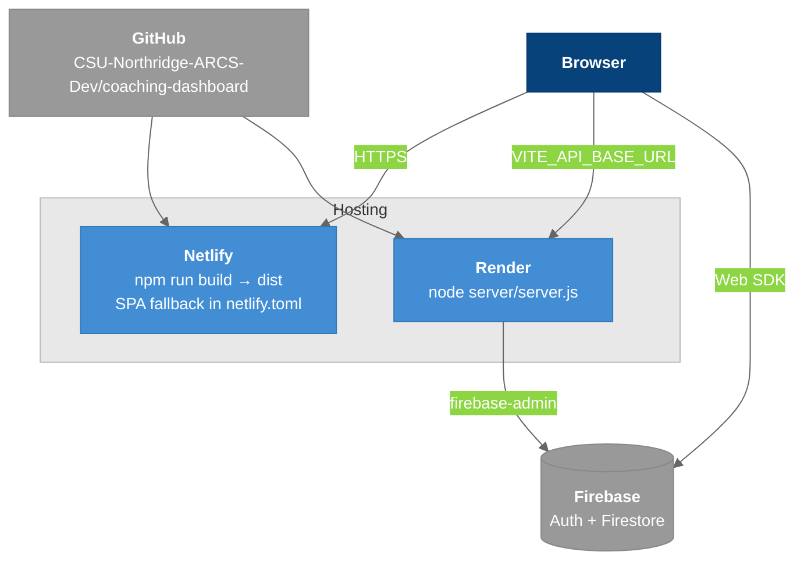

# Deployment

Two of the three containers are deployed, to two providers, from one repository: the SPA to Netlify and the API to Render.

---

## Overview

| Container | Host | Config | Notes |
|-----------|------|--------|-------|
| Web SPA | **Netlify** | `netlify.toml` | `npm run build`, publish `dist` |
| Insights API | **Render** | Render dashboard | runs `node server/server.js` |
| Email service | — | — | not deployed ([[Email_Service]]) |

No refactor phase has been verified against a real Netlify build. Every phase since 2 lists "the Netlify build" under *Not verified*; the first deploy of the `refactor` branch is the proof.

---

## Diagram



### Legend

- **Blue** = what we deploy
- **Gray** = external systems

---

## Netlify

```toml
[build]
  command = "npm run build"
  publish = "dist"

# SPA fallback — without this, hard-refreshing a deep link 404s.
[[redirects]]
  from = "/*"
  to = "/index.html"
  status = 200
```

### The SPA fallback (fixed in Phase 2)

A single-page app needs every path to serve `index.html`, or a refresh on `/team-insights` returns a 404 from the CDN. Before the refactor the rule lived in `public/_redirects` at the repo root, but Vite's root was `src/` and the build went to `src/dist`, so the file never reached the published directory. Phase 2 normalized the Vite layout, moved the rule into `netlify.toml` (which removes the file-placement question entirely) and deleted `public/_redirects`.

**Verify it on the live site** after the first deploy of `refactor`: hard-refresh a deep link such as `/team-insights`. Do not navigate there from within the app; client-side routing always works.

### Environment

`VITE_*` variables must be set in **Netlify's** environment because Vite inlines them at build time:

- Changing `VITE_API_BASE_URL` requires a **rebuild and redeploy**, not just an env edit.
- "I set the variable and it still doesn't work" almost always means "and did not redeploy".

See [[Configuration]].

### Case sensitivity

Netlify builds on Linux. A wrong-case import (`@/Pages/Login` for `src/pages/Login.jsx`) works on Windows and breaks the deploy. Phases 2 and 3 each hit a version of this; `import/no-unresolved` with `caseSensitive: true` now makes it a lint error. Run `npm run lint` before pushing.

---

## Render

| Variable | Why |
|----------|-----|
| `FIREBASE_SERVICE_ACCOUNT_JSON` | The whole service-account JSON as one string. Without it the process exits at boot |
| `FRONTEND_ORIGIN` | The Netlify origin, e.g. `https://your-site.netlify.app` |

**`FRONTEND_ORIGIN` is not optional in production.** With it unset, every browser request from the deployed frontend is rejected by CORS. Symptom: charts empty, console full of CORS errors, the API perfectly healthy when curled.

Render's free tier sleeps idle services. The first request after a sleep takes tens of seconds, which looks like a hang rather than a cold start.

---

## Deploy Checklist

1. `VITE_API_BASE_URL` on Netlify points at the Render URL, no trailing slash.
2. `FRONTEND_ORIGIN` on Render exactly matches the Netlify origin: scheme included, no trailing slash.
3. Redeploy the frontend after any `VITE_*` change.
4. Hard-refresh a deep link to confirm the SPA fallback.
5. Sign in and load [[Team_Insights]] with a 2025-03-26 → 2025-03-28 range: the only page that works against the deployed API ([[Frontend_Data_Flow]]).

## What Deploying Does Not Give You

`Admin`, `AthleteInfo` and `Vo2MaxChart` fetch bare paths that only resolve through the Vite dev proxy. They render, and stay empty, in production. That is expected today, not a regression. See [[Known_Issues]] #6.

---

## Key Files

| File | Purpose |
|------|---------|
| `netlify.toml` | Build, publish dir, SPA fallback |
| `vite.config.js` | `build.outDir: "dist"` |
| `server/server.js` | CORS allowlist, credential load, `PORT` |

---

## Related Notes

- [[03-Container]]
- [[Configuration]]
- [[Local_Dev_Setup]]
- [[Refactor_Phase_2_Vite_Layout]]
