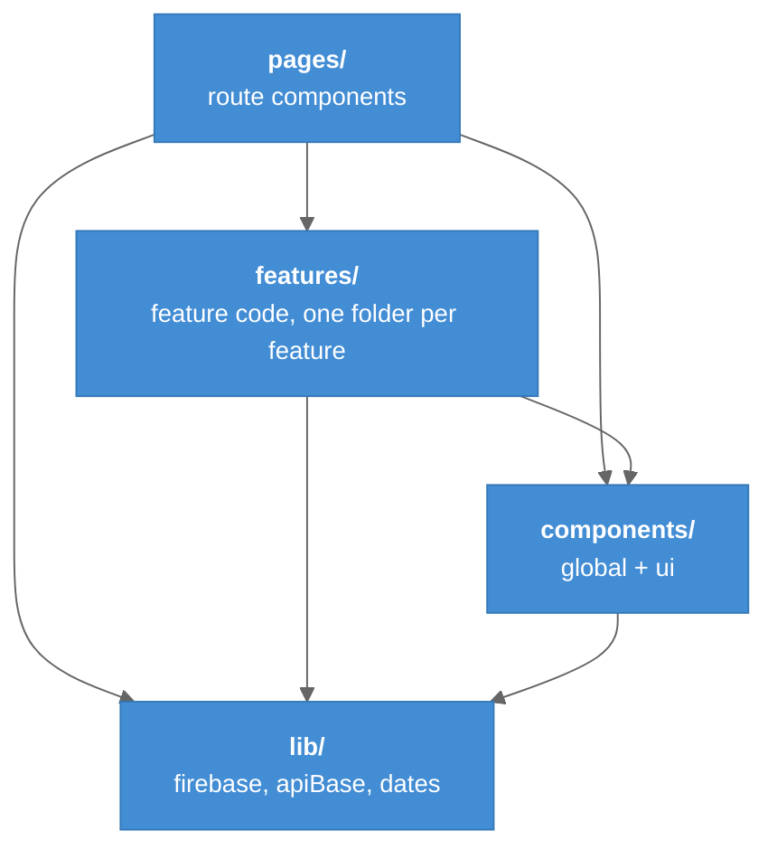

# Project Structure

How the repository is laid out after the refactor's Phase 3, the layering rule the linter enforces, and where this vault sits among the project's other documents.

---

## Overview

The repo is a standard Vite layout (entry `index.html` at the root, build to `dist/`) with a **feature-oriented `src/`**: route components in `pages/`, feature code in `features/<name>/`, shared UI in `components/`, and framework-free helpers in `lib/`. The shape is modelled on `vip-web-frontend`: thin route → feature component → externalized data, a `@/` path alias, and `components/ui` vs `components/global` tiering. The reasoning is in [[Refactor]] problem 1.

---

## Repository Tree

```
coaching-dashboard/
├── index.html                  Vite entry (moved from src/ in Phase 2)
├── vite.config.js              @ alias, dist/ output, dev proxy, vitest config
├── tailwind.config.js          content globs only
├── netlify.toml                build + SPA fallback
├── firestore.rules             prototype rules, not deployed from here (no firebase.json)
├── .env.example                frontend env template (.env.local lives beside it)
├── .eslintrc.cjs · .prettierrc · .prettierignore · .editorconfig
├── server/
│   ├── server.js               the Insights API, one file, 655 lines
│   └── service-account.example.json
├── email-service/
│   └── server.js               invitation mailer, 46 lines
├── src/
│   ├── main.jsx                mount + explicit import "./lib/firebase"
│   ├── App.jsx                 router only
│   ├── style.css               3 lines: the @tailwind directives
│   ├── lib/                    apiBase.js · dates.js · firebase.js
│   ├── components/
│   │   ├── global/             Navbar · Footer · ProtectedRoute
│   │   └── ui/                 DashboardCard · PopupCalendar · SyncedSegmentedToggle
│   ├── features/
│   │   ├── coach-dashboard/    components/ (12 cards + header + teamBuilderClasses.js)
│   │   │                       context/DashboardAutoCycleContext.jsx · data/ (12 mock modules)
│   │   ├── team-insights/      components/ MultiHeartGraph · SleepStageGraph · graphClasses.js
│   │   ├── athlete-health/     components/ ActivityRing · HeartGraph · SleepTimeline · Vo2MaxChart
│   │   ├── invitations/        api/ sendInvitation · fetchPendingInvitations
│   │   │                       components/ InviteForm · PendingInvitations
│   │   ├── athlete-access/     data/athletes.js (pre-staged for the page split)
│   │   └── settings/           components/SettingsNavbar
│   ├── pages/                  Admin · AthleteAccess · AthleteDashboard · AthleteInfo
│   │   │                       CoachDashboard · Invitation · Login · Register · TeamInsights
│   │   └── settings/           Settings + 5 sub-pages
│   ├── assets/images/          ARCS.jpg
│   ├── __tests__/              login.test.jsx · routes.test.jsx
│   └── setupVitest.js
├── docs/                       refactor-phases.md · PROJECT-READINESS.md · ai-orchestration.md (gitignored)
├── tickets/                    BACKLOG.md · SEC-1/ · SEC-2/ (gitignored)
└── coaching-dashboard-documentation/   this vault (gitignored)
```

---

## The Layering Rule

Imports flow one way. `import/no-restricted-paths` in `.eslintrc.cjs` makes a violation a lint **error**, so this is enforced rather than described.



### Legend

- **Arrow** = "may import from". Anything not drawn is a lint error.
- Feature → feature imports are **not** restricted, and none exist. Adding that zone is one line in `.eslintrc.cjs` and the owner's call.

| Tier | May not import from |
|------|---------------------|
| `lib/` | `components/`, `features/`, `pages/` |
| `components/` | `features/`, `pages/` |
| `features/` | `pages/` |

`import/no-unresolved` runs with `caseSensitive: true`. A wrong-case path such as `@/Pages/Login` is a lint error even on Windows, where the import would otherwise work locally and break the Linux build on Netlify. That exact bug hit Phases 2 and 3. See [[Refactor_Phase_3_Features]].

### Where a new file goes

| You are adding… | Put it in |
|-----------------|-----------|
| A new route | `src/pages/` (thin: compose feature components) |
| Code used by one feature | `src/features/<feature>/components` · `api` · `data` · `context` |
| A reusable visual primitive | `src/components/ui/` |
| App chrome used on every page | `src/components/global/` |
| A pure helper with no React | `src/lib/` |
| Mock data a real API will replace | `src/features/<feature>/data/`, passed as a prop defaulting to the module |

New imports use `@/…`. The only relative import left in `src/` is `main.jsx → "./App"`.

---

## Where This Vault Sits

Three documents describe the project and deliberately do not overlap:

| Document | Audience | Answers |
|----------|----------|---------|
| `README.md` (repo) | a human arriving at the repo | What is this? How do I run it? |
| `AGENTS.md` (via `CLAUDE.md`) | coding agents | How does the code work? What are the conventions? |
| **this vault** | the owner and the incoming capstone team, over time | *Why* is it this way? What did we do and decide? |

When a fact belongs in two places it lives in the one furthest left, and the others link to it. `AGENTS.md` stays the source of truth for stack, layout, data model and conventions. The vault explains and extends it; it does not fork it.

`AGENTS.md`, `CLAUDE.md`, `docs/`, `tickets/`, `.claude/` and this vault are all **gitignored**. They exist only on the owner's machine.

---

## Key Files

| File | Purpose |
|------|---------|
| `src/main.jsx` | Mount point; the explicit Firebase import that makes bare `getAuth()` safe |
| `src/App.jsx` | Route table, all wrapped in `ProtectedRoute` except `/` and `/register` |
| `.eslintrc.cjs` | Layering zones, case-sensitive resolution |
| `jsconfig.json` | Mirrors the `@` alias for editors |

---

## Related Notes

- [[Tech_Stack]]
- [[Refactor]]
- [[04-Component-Frontend]]
- [[README|Vault home]]
