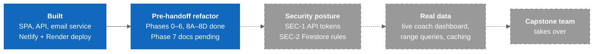

# Roadmap

What is built, what the refactor is finishing, and what comes next for the capstone handoff. Sourced from `docs/refactor-phases.md` and `tickets/BACKLOG.md`.

---

## Overview

### Legend

- **Blue** = done (the refactor is done except Phase 7)
- **Gray, dashed** = planned

---

## Built

- Role-gated SPA: coach, athlete and admin home routes. See [[Auth_And_Roles]].
- Team Insights reading live Firestore time series through the API. See [[Team_Insights]].
- Coach dashboard as a worked-out design over mock data. See [[Coach_Dashboard]].
- Invitation records in Firestore; an email service that nothing calls yet. See [[Email_Service]].
- Deployed: SPA on Netlify, API on Render. See [[Deployment]].

## The Refactor (branch `refactor`)

| Phase | What | Status |
|-------|------|--------|
| 0 | Branch + baseline | Done |
| 1 | Delete dead code and dependencies | Committed `b539ba3` |
| 2 | Normalize the Vite layout, fix deploy bugs | Committed `45f4258` |
| 3 | Restructure into `features/` | Committed `4fa4ca3`, `d7443a9` |
| 4 | Extract the coach dashboard's static data | Committed `28a8a25` |
| 5 | Styling pass 1 | Committed `d9c5d92` |
| 6 | Tooling: ESLint, Prettier, dev scripts | Committed `99a9eb6` |
| 7 | Documentation refresh | **Not started** (this vault restructure covers the vault part) |
| 8A–8D | Tailwind conversion + inline styles | Committed `d9c5d92`, `1374879`, `5ae5ae6` |

Rationale for every phase: [[Refactor]]. Live status: `docs/refactor-phases.md`.

## Next: before real athlete data

1. [[SEC_1_API_Auth_Tokens]]: verify a Firebase ID token on every API route. *(planned)*
2. [[SEC_2_Firestore_Rules]]: scope rules to what each caller owns, and add `firebase.json` so they can be deployed and tested. *(planned)*
3. Remove the console logging of user documents. See [[Known_Issues]] #3.

## Next: make the data trustworthy

- Range-query Firestore instead of reading whole subcollections, plus client caching. Actively failing today (quota). *(planned)*
- Surface API failures instead of rendering empty. *(planned)*
- Seed recent health data server-side with `firebase-admin`. Health data is never client-writable. *(planned)*
- Wire the coach dashboard cards to the API; the prop seams from Phase 4 are ready. *(planned)*
- Migrate remaining pages to `apiUrl()`. *(planned)*

## Next: tooling

- Make `npm run lint` warning-free (39 a11y / hooks warnings). *(planned)*
- Upgrade ESLint, Prettier, Vite and Vitest, one PR each. *(planned)*
- Export and test the API's pure helpers. *(planned)*

---

## Related Notes

- [[Known_Issues]]
- [[Refactor]]
- [[Ticket/README|Ticket index]]
