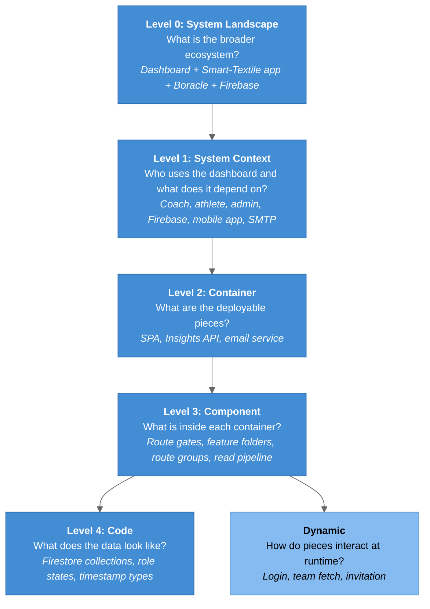

# C4 Model - Coaching Dashboard Architecture

## What is the C4 Model?

The C4 model (Context, Containers, Components, Code), created by Simon Brown, is a set of hierarchical architecture diagrams. It describes a software system at four zoom levels, plus supplementary landscape and dynamic views.

## Diagram Index

| Level | Diagram | File | Description |
|-------|---------|------|-------------|
| **0** | [System Landscape](01-SystemLandscape.md) | `01-SystemLandscape.md` | CSUN ARCS ecosystem: Coaching Dashboard, Smart-Textile app, Boracle, Firebase |
| **1** | [System Context](02-SystemContext.md) | `02-SystemContext.md` | The dashboard, its three roles, and external systems |
| **2** | [Container](03-Container.md) | `03-Container.md` | Web SPA, Insights API, email service; the two paths to Firebase |
| **3a** | [Component (Frontend)](04-Component-Frontend.md) | `04-Component-Frontend.md` | Routes, gates, pages, features, lib |
| **3b** | [Component (API)](05-Component-API.md) | `05-Component-API.md` | Middleware, route groups, the shared read pipeline |
| **4** | [Code](06-Code.md) | `06-Code.md` | Firestore ER schema, role routing states, `toDate()` normalization |
| **Dyn** | [Dynamic](07-Dynamic-Diagrams.md) | `07-Dynamic-Diagrams.md` | Login + role redirect, Team Insights fetch, invitation |

## C4 Abstraction Levels



### Legend

- **Blue** = C4 levels
- **Light blue** = supplementary dynamic view

## Diagram Conventions

Shared with the VIP-Docs and Boracle-Docs vaults, so all three read the same. Every diagram starts with this init line:

```
%%{init: {'theme': 'base', 'flowchart': {'useMaxWidth': true}, 'themeVariables': {'primaryColor': '#438DD5', 'primaryTextColor': '#fff', 'lineColor': '#666', 'fontSize': '14px'}}}%%
```

| Element | Hex | Usage |
|---------|-----|-------|
| Users / Actors | `#08427B` | Coach, athlete, admin |
| Main System | `#1168BD` | The Coaching Dashboard as a whole |
| Containers / Components | `#438DD5` | What we build |
| External Systems | `#999` | Firebase, the mobile app, SMTP, Netlify, Render |
| Planned / not reached | `#999` + `stroke-dasharray: 5 5` | Not built, or built but uncalled (the email POST). Also dashed arrows `-.->` |
| Problem path | `#C94C4C` | Used sparingly, for a path that fails (the dev-only fetch style, the refresh bug) |
| Boundaries | `#E8E8E8` | Subgraph background |

Nodes are styled with either `style` lines or `classDef` / `class`; both produce the same result. Node labels look like `id["<b>Name</b><br/>short description"]`, with no HTML entities or semicolons inside diagram text.

Diagram types:

- `flowchart TD` for landscape, context, container and component diagrams
- `sequenceDiagram` with `rect rgb(...)` blocks for dynamic flows
- `erDiagram` for the Firestore schema
- `stateDiagram-v2` for role routing

The Context, Container and Component diagrams also appear in the repo's `README.md`. That is the one duplication this vault accepts: change one, change both.

## Key Architecture Decisions Visible in Diagrams

| Decision | Visible In | Diagram |
|----------|-----------|---------|
| The dashboard reads Firestore; a separate mobile app writes it. Firestore is the system of record | Landscape, Context | mobile app → Firestore, dashboard reads |
| Two paths to Firebase: the browser SDK for auth/roles/invitations, the API's service account for health data | Container | two arrows into Firestore |
| The API normalizes inconsistent documents on read (`toDate`, `pickRows`) | Component (API), Code | read pipeline |
| Roles are enforced twice in the browser (`ProtectedRoute` + `<AllowedAccess>`) and not at all on the server | Component (Frontend), Dynamic | two gates, no API check |
| Only `apiUrl()` works against the deployed API | Container, Component (Frontend) | dev proxy vs `VITE_API_BASE_URL` |
| Feature-oriented `src/` with an enforced import direction | Component (Frontend) | pages → features → components → lib |
| The coach dashboard renders mock data modules, not the API | Component (Frontend) | no arrow from cards to API |
| The email service exists but has no caller | Container, Dynamic | dashed SPA → email arrow |
| Boracle integration is planned, not built | Landscape | dashed arrow |

## Related Notes

- [[SystemDesign/README|System Design]]
- [[Project_Structure]]
- [[Tech_Stack]]
