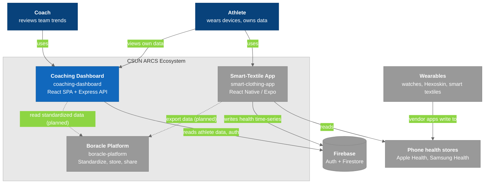

# C4 Model - Level 0: System Landscape

The CSUN ARCS wearable-health ecosystem the Coaching Dashboard belongs to. The dashboard is a **read-and-render layer** over data another app writes.

- **Smart-Textile App** (`smart-clothing-app`): the athlete's mobile app. It syncs health data from the phone's health store into Firestore.
- **Coaching Dashboard** (this repo): reads that Firestore data and shows it to coaches.
- **Boracle Platform**: ARCS's standardization and consent middleware. The dashboard does **not** call it yet; that integration is planned.

## Diagram

### Legend

- **Dark blue** = people
- **Blue (strong)** = the Coaching Dashboard, the system this vault documents
- **Gray** = sibling ARCS systems and external services (they exist)
- **Solid arrow** = code in the relevant repo makes this call today
- **Dashed arrow** = planned relationship

## Systems

| System | Repo | Stack | Relationship to the dashboard |
|--------|------|-------|-------------------------------|
| **Coaching Dashboard** | `CSU-Northridge-ARCS-Dev/coaching-dashboard` | React 18 + Vite (Netlify), Express + firebase-admin (Render) | — |
| **Smart-Textile App** | `CSU-Northridge-ARCS-Dev/smart-clothing-app` | React Native, Expo, Firebase | Writes every health document the dashboard reads. Not called by the dashboard |
| **Boracle Platform** | `CSU-Northridge-ARCS-Dev/boracle-platform` | Spring Boot 3, PostgreSQL, Firebase Auth | None in code. Documented in the Boracle-Docs vault |
| **Firebase** | — | Auth + Firestore | Auth for sign-in; Firestore is the system of record for users, invitations and health data |

## Why This Matters

- **The dashboard cannot fix data at the source.** Field names and timestamp types differ by writer, so the API normalizes on read. See [[Data_Model]].
- **Empty charts are often an upstream problem.** The newest sample in the project is 2025-03-27. Check that documents exist before debugging a chart.
- **Two ingestion paths exist in the ecosystem.** Boracle's Middleman App uploads to Boracle's PostgreSQL; the Smart-Textile App writes Firestore. The dashboard only sees the second.
- **Roles differ across systems.** Dashboard roles are `admin` / `coach` / `athlete` on `Users/{uid}`; Boracle's are `END_USER` / `DEVELOPER`. An integration needs a mapping.

> **Discrepancy with Boracle-Docs.** Its landscape draws "Coaching Dashboard → push invites via Expo → Smart-Textile App". No Expo or push-notification code exists in this repo on `refactor` or `main`. If that call exists, it lives in another repo or branch. Confirm before relying on either diagram.

## Related Notes

- [[02-SystemContext]]
- [[00-C4-Overview]]
- [[Data_Model]]
