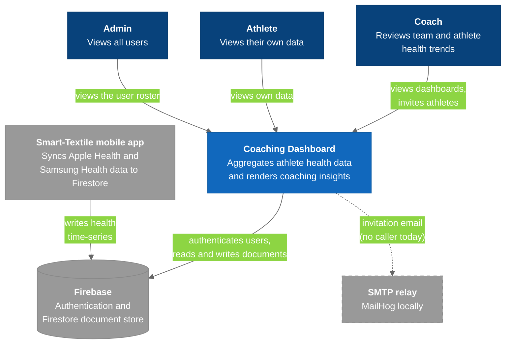

# C4 Model - Level 1: System Context

Who uses the Coaching Dashboard, and what it depends on. The repo `README.md` carries a copy of this diagram; change one, change both.

## Diagram

### Legend

- **Dark blue** = people (the three roles)
- **Blue (strong)** = the Coaching Dashboard
- **Gray** = external systems
- **Gray, dashed** = exists, but the dashboard does not currently reach it

## What This Diagram Is Really Saying

**The dashboard is not the system of record.** Firestore is, and it is filled by a mobile app in a different repository. This project is, structurally, a read-and-render layer over someone else's write path. That explains most of the design:

- There is no ingestion code and no schema enforcement. Whatever the mobile app writes is what the API has to cope with, which is why [[Data_Model]] is mostly about *tolerating* inconsistent field names.
- Data quality problems are usually upstream. If a chart is empty, check that documents exist (and that the date range reaches March 2025) before debugging the chart.
- Bad timestamps cannot be fixed at the source, so they are normalized on read. See [[API_Endpoints]].

## The Three Actors

| Actor | Home route | What they can do |
|-------|------------|------------------|
| Coach | `/coach` | Team dashboard (mock data), Team Insights (live data), per-athlete view, invitations, settings, athlete access |
| Athlete | `/athlete` | Their own dashboard (thin today) |
| Admin | `/admin` | Roster of all users. The role-change form was removed; `/api/updateRole` has no UI caller |

Roles are enforced twice in the browser and not at all on the server. See [[Auth_And_Roles]].

## Institutional Context

The project comes out of the ARCS program at CSU Northridge; the ARCS mark (`src/assets/images/ARCS.jpg`) is used in the app's chrome. The "smart clothing" phrasing in the invitation email (`email-service/server.js`) points at the wearable platform this dashboard was built to accompany. See [[01-SystemLandscape]].

## Key Relationships

| Relationship | Protocol | Purpose |
|-------------|----------|---------|
| Users → Dashboard | HTTPS | Browser SPA on Netlify |
| Dashboard → Firebase | Firebase Web SDK + `firebase-admin` | Auth, roles, invitations, health data |
| Mobile app → Firebase | Firebase SDK | The only writer of health time-series |
| Dashboard → SMTP | SMTP via nodemailer | Invitation email; not reached today |

## Related Notes

- [[01-SystemLandscape]]
- [[03-Container]]
- [[Auth_And_Roles]]
