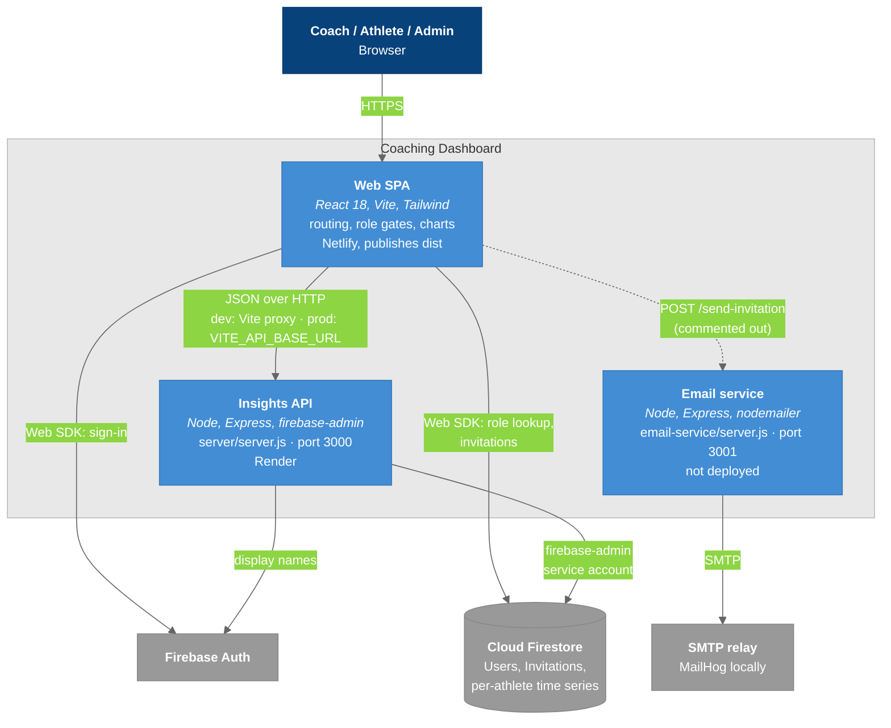
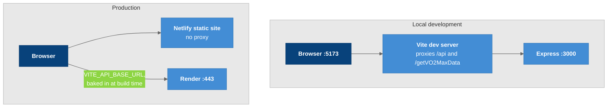

# C4 Model - Level 2: Container Diagram

The three separately runnable pieces in the repo and how they communicate. Solid lines exist today; dashed lines exist in code but are not reached. The repo `README.md` carries a copy; change one, change both.

## Diagram

### Legend

- **Dark blue** = users
- **Blue** = containers we build
- **Gray** = external systems
- **Dashed arrow** = in code, not reached
- **Light border** = system boundary

## Container Details

| Container | Source | Technology | Port (dev) | Deployed to |
|-----------|--------|-----------|------------|-------------|
| **Web SPA** | `src/`, `index.html` | React 18, Vite 3, Tailwind 3, Firebase Web SDK | 5173 | Netlify, publishing `dist` |
| **Insights API** | `server/server.js` | Node, Express 4, firebase-admin 12 | 3000 | Render |
| **Email service** | `email-service/server.js` | Node, Express 4, nodemailer 10 | 3001 | nowhere: local only, and uncalled |

They share one `package.json`, one `node_modules`, and one repository, but no code module. See [[Tech_Stack]].

## The Two Paths to Firebase

The SPA talks to Firestore **twice, differently**, and confusing the two is the most common source of "works locally but not deployed".

| Path | Credential | Used for | Why |
|------|------------|----------|-----|
| Browser → Firestore | The signed-in user | Sign-in, the role lookup in `ProtectedRoute`, invitation documents | Cheap, no server round trip, Firestore rules apply |
| Browser → API → Firestore | A service account | Every health metric | The API needs `admin.auth().getUser()` for display names, and the raw documents need heavy normalization before a chart can use them |

Consequences:

- The API holds a **privileged credential** and does no per-user authorization. Anyone who can reach it can ask for any `userId`. See [[API_Endpoints]].
- Killing the API breaks charts but leaves login working. That asymmetry is a useful debugging signal.

## Dev vs. Production Wiring

### Legend

- **Dark blue** = the browser
- **Blue** = what serves it in each environment

In development the Vite proxy makes bare relative paths like `/api/getHeartRate` work. In production there is no proxy, so **only** code routed through `apiUrl()` reaches the API, and only `TeamInsights` does that. See [[Frontend_Data_Flow]].

CORS on the API allows exactly `http://localhost:5173` plus `FRONTEND_ORIGIN`. Anything else is rejected, which is the other half of why a deployed frontend can fail while local works. See [[Deployment]].

## Data Flow Summary

| Flow | Direction | Data | Format |
|------|-----------|------|--------|
| Browser → SPA | Request | Pages, bundle | HTML / JS |
| SPA → Firebase Auth | SDK | Sign-in | Firebase protocol |
| SPA → Firestore | SDK | `Users/{uid}.role`, `Invitations` | Firestore documents |
| SPA → API | Request | Roster, per-athlete and team time series | JSON |
| API → Firestore | Admin SDK | Full subcollection reads | Firestore documents |
| API → Auth | Admin SDK | `getUser()` display names | — |

## Key Relationships

| Relationship | Protocol | Purpose |
|-------------|----------|---------|
| SPA ↔ API | REST-ish JSON, `/api/*` | Health data and rosters |
| SPA ↔ Firestore | Firebase Web SDK | Auth, role gate, invitations |
| API ↔ Firestore | firebase-admin | Health data, rosters; bypasses security rules |
| SPA ↔ Email service | HTTP POST | **none today**: the call is commented out |

## Related Notes

- [[02-SystemContext]]
- [[04-Component-Frontend]]
- [[05-Component-API]]
- [[Deployment]]
