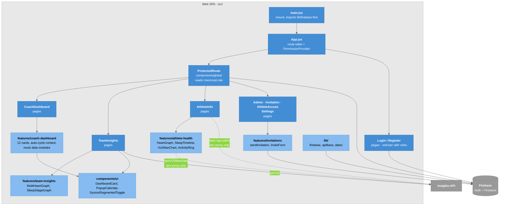

# C4 Model - Level 3a: Component Diagram (Frontend)

Inside the Web SPA after the refactor: the router and its two gates, the pages, the feature folders they compose, and the `lib/` helpers. The repo `README.md` carries a copy; change one, change both.

## Diagram

### Legend

- **Blue** = entry, router, gate and pages
- **Light blue** = feature folders and shared tiers
- **Gray** = other containers and Firebase
- **Dashed arrow** = works only through the Vite dev proxy
- `CoachDashboard` has **no** arrow to the API: its cards render mock modules

## Components

| Component | Location | Responsibility |
|-----------|----------|----------------|
| Entry | `src/main.jsx` | `createRoot`; imports `./lib/firebase` **before** rendering so every bare `getAuth()` / `getFirestore()` has an initialized app. Do not remove that import |
| Router | `src/App.jsx` | Route table only |
| Gate 1 | `src/components/global/ProtectedRoute.jsx` | Firestore role read and redirect. See [[Auth_And_Roles]] |
| Gate 2 | `<AllowedAccess>` in pages | In-memory role context, set only by `Login.jsx` |
| Coach dashboard | `pages/CoachDashboard.jsx` + `features/coach-dashboard/` | Card grid over mock data; shared 6.5s tick. See [[Coach_Dashboard]] |
| Team insights | `pages/TeamInsights.jsx` + `features/team-insights/` | The live-data page. See [[Team_Insights]] |
| Athlete health | `pages/AthleteInfo.jsx` + `features/athlete-health/` | Single-athlete charts (dev proxy only) |
| Invitations | `pages/Invitation.jsx` + `features/invitations/` | Firestore invitation records. See [[Email_Service]] |
| Shared UI | `components/ui/`, `components/global/` | Card shell, calendar, segmented toggle; navbar, footer |
| Helpers | `lib/` | `firebase.js` (the only `initializeApp`), `apiBase.js`, `dates.js` |

## Route Table

Every route is wrapped in `<ProtectedRoute requiredRole="...">` except `/` and `/register`.

| Path | Required role | Page |
|------|---------------|------|
| `/` | — | `Login` |
| `/register` | — | `Register` |
| `/admin` | admin | `Admin` |
| `/athlete` | athlete | `AthleteDashboard` |
| `/coach` | coach | `CoachDashboard` |
| `/info` | coach | `AthleteInfo` |
| `/team-insights` | coach | `TeamInsights` |
| `/invitation` | coach | `Invitation` |
| `/athlete-access` | coach | `AthleteAccess` |
| `/settings`, `/settings/{profile,team,notifications,dashboard,appearance}` | coach | `settings/Settings` + sub-pages |

`Login.jsx` navigates to `/home` in its fallback branches, and no `/home` route exists.

## Import Direction

`pages → features → components → lib`, enforced by `import/no-restricted-paths`. The full rule and "where does a new file go" table is in [[Project_Structure]].

## Key Relationships

| Relationship | Protocol | Purpose |
|-------------|----------|---------|
| `main.jsx` → `lib/firebase` | ES import (side effect) | Deterministic Firebase init |
| Pages → features | ES import via `@/` | Thin route, feature does the work |
| `TeamInsights` → API | `fetch(apiUrl(...))` | Works in dev and production |
| `AthleteInfo`, `Admin`, `Vo2MaxChart` → API | bare `fetch` / `axios` | Dev proxy only |
| `ProtectedRoute`, `Login`, invitations → Firestore | Web SDK | Roles and invitations |

## Related Notes

- [[03-Container]]
- [[05-Component-API]]
- [[Project_Structure]]
- [[Frontend_Data_Flow]]
