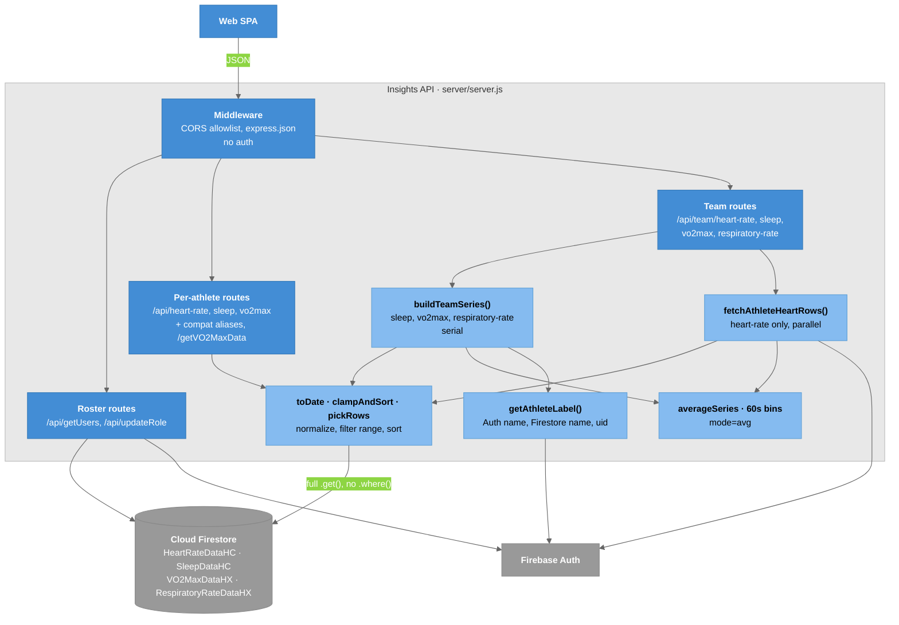

# C4 Model - Level 3b: Component Diagram (Insights API)

Inside `server/server.js`: middleware, three route groups, and the read pipeline every route shares. One file, 655 lines. The repo `README.md` carries a copy; change one, change both.

## Diagram



### Legend

- **Blue** = middleware and route groups
- **Light blue** = module-scope helpers (all unexported)
- **Gray** = Firebase

## The Read Pipeline Every Route Shares

```
Firestore snapshot (the whole subcollection)
   ↓  clampAndSort(docs, startISO, endISO, pickRows)
   ↓     pickRows(doc)  per-metric field-name mapper, returns { ts, ...shaped }
   ↓     toDate(v)      Timestamp | { _seconds } | epoch ms | ISO string → Date
   ↓     filter to [start, end]
   ↓     sort ascending by ts
shaped rows → route-specific response shape
```

Two structural facts:

1. **Filtering happens in Node, not in Firestore.** Every route does a full `.get()` on the subcollection and discards documents outside the range afterwards. That exhausted the daily read quota on 2026-09-07. See [[API_Endpoints]].
2. **`pickRows` is where source inconsistency is absorbed.** Heart rate accepts `beatsPerMinute ?? bpm ?? y`; respiratory rate accepts `respiratoryRate ?? breathsPerMinute ?? rate ?? value ?? y`. [[Data_Model]] lists them all.

## Components

| Component | Responsibility |
|-----------|----------------|
| Credential load | `FIREBASE_SERVICE_ACCOUNT_JSON`, else `./firebase-service-account-prototype.json`, else exit naming both |
| CORS | `localhost:5173` + `FRONTEND_ORIGIN`; requests with no `Origin` pass |
| Roster routes | Resolve `authorizedAthletes` DocumentReferences one at a time; join Auth display names |
| Per-athlete routes | One subcollection, one athlete |
| Team routes | Many athletes; `overlay`/`grid` return `series`, `avg` returns `average` |
| `buildTeamSeries` | Shared by three team routes; serial; exact-timestamp averaging |
| `fetchAthleteHeartRows` | Heart-rate's own path; parallel; 60-second bins |
| `getAthleteLabel` | Auth `displayName` → Firestore name → uid |

## Key Relationships

| Relationship | Protocol | Purpose |
|-------------|----------|---------|
| SPA → API | HTTP JSON | Every health metric and roster |
| API → Firestore | firebase-admin, service account | Reads; bypasses security rules |
| API → Auth | firebase-admin | Display names; `getUserByEmail` for `updateRole` |

## Related Notes

- [[API_Endpoints]]
- [[03-Container]]
- [[06-Code]]
- [[Data_Model]]
