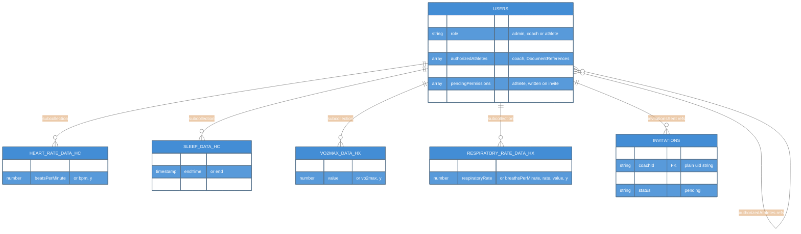
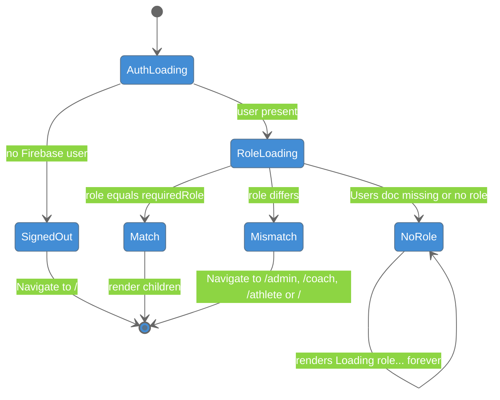
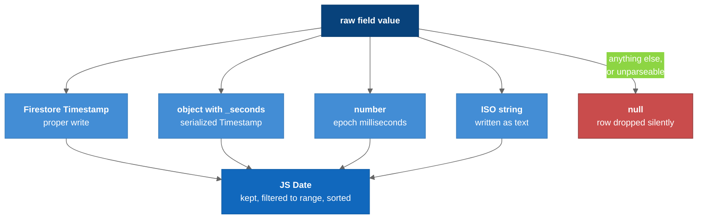

# C4 Model - Level 4: Code

The data and logic at code level: the Firestore schema the API reads, the role routing state machine in `ProtectedRoute`, and the `toDate()` normalization every time-series row passes through.

## 1. Firestore Schema

Observed, not enforced: the mobile app writes it. Field-level spellings and the full reasoning are in [[Data_Model]].



### Legend

- One box per collection or subcollection; quoted text lists alternative spellings the API accepts
- Relationships are conventions: Firestore has no joins, foreign keys or cascades
- `HX` = Hexoskin (from a server comment); `HC` is unconfirmed

Literal paths:

```
Users/{uid}
Users/{uid}/HeartRateDataHC/{docId}          Users/{uid}/VO2MaxDataHX/{docId}
Users/{uid}/SleepDataHC/{docId}              Users/{uid}/RespiratoryRateDataHX/{docId}
Invitations/{invitationId}
```

## 2. Role Routing (`ProtectedRoute`)



### Legend

- `AuthLoading` and `RoleLoading` render `Loading...` / `Loading role...`
- `NoRole` is a dead end: it is what the `matthew@gmail.com` test account hits
- Passing this gate does **not** mean the page renders: `<AllowedAccess>` is a second, independent gate. See [[Auth_And_Roles]]

## 3. Timestamp Normalization (`toDate`)



### Legend

- **Blue** = the four accepted input types
- **Red** = the silent drop: no log, just fewer chart points

Sleep rows are intervals: they are kept if they **intersect** the requested window, not only if they fall inside it.

## Key Relationships

| Relationship | Where | Purpose |
|-------------|-------|---------|
| `authorizedAthletes` → `Users` | coach doc | The roster `/api/getUsers` reads, one `get()` per reference |
| `Invitations.coachId` → `Users` | plain string | Queried with `where("coachId", "==", …)` |
| `toDate` ← every `pickRows` | `server/server.js` | One timestamp funnel for all metrics |

## Related Notes

- [[Data_Model]]
- [[05-Component-API]]
- [[Auth_And_Roles]]
- [[07-Dynamic-Diagrams]]
