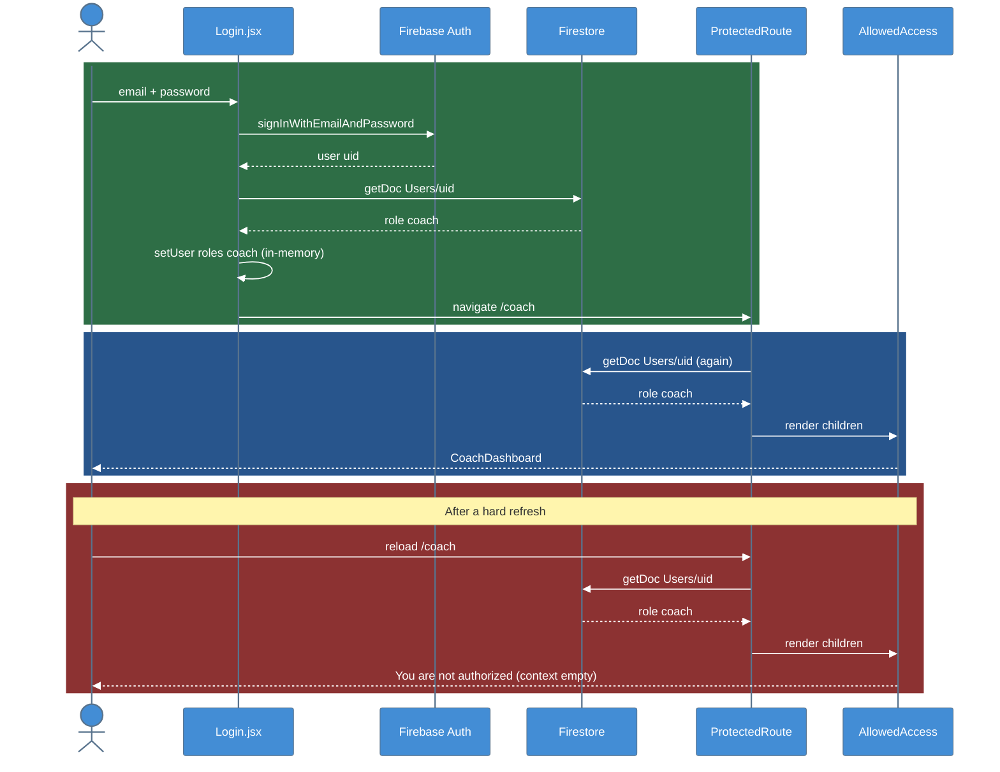
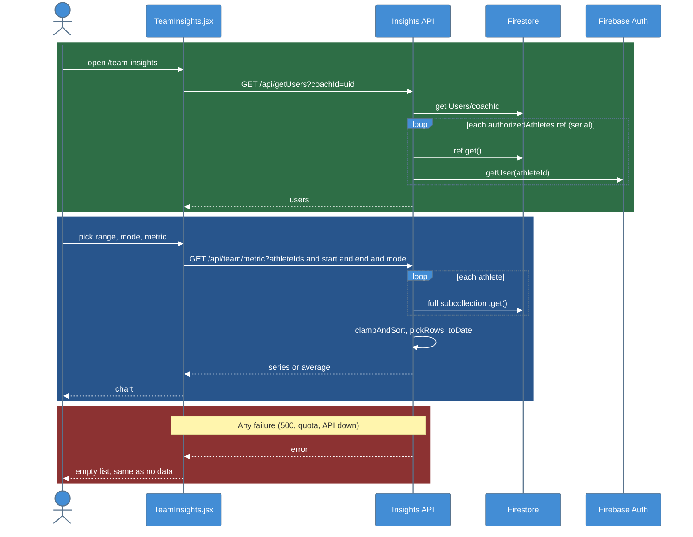

# C4 Model - Dynamic Diagrams

Runtime flows: how the pieces interact for the three things a coach actually does. Each is drawn from the code on `refactor @ 99a9eb6`.

## 1. Login and Role Redirect

### Legend

- **Green** = sign-in; the only place the permission context is set
- **Blue** = the normal gated render
- **Red** = the refresh bug: Gate 1 re-reads Firestore, Gate 2 has lost its context

## 2. Team Insights Fetch

### Legend

- **Green** = roster load (N+1, serial)
- **Blue** = the data request: every athlete's whole history is read, then filtered in Node
- **Red** = failures render identically to an empty result

Every change of range, mode, metric or selection repeats the blue block. See [[Team_Insights]] and [[API_Endpoints]].

## 3. Coach Invites an Athlete

```mermaid
%%{init: {'theme': 'base', 'flowchart': {'useMaxWidth': true}, 'themeVariables': {'primaryColor': '#438DD5', 'primaryTextColor': '#fff', 'lineColor': '#666', 'fontSize': '14px'}}}%%
sequenceDiagram
    actor C as Coach
    participant I as InviteForm
    participant S as sendInvitation.js
    participant F as Firestore
    participant E as Email service

    rect rgb(46, 110, 70)
    C->>I: athlete email
    I->>S: sendInvitation(email)
    S->>F: query Users where email
    F-->>S: athlete doc
    S->>F: addDoc Invitations status pending
    S->>F: arrayUnion coach invitationsSent
    S->>F: arrayUnion athlete pendingPermissions
    S-->>I: Inviation sent successfully.
    end

    rect rgb(95, 95, 95)
    Note over S,E: Commented out, never runs
    S--)E: POST /send-invitation
    end
```

### Legend

- **Green** = what runs today: Firestore writes only
- **Gray** = the email POST, present only as a comment
- There is no accept step: nothing moves the athlete into the coach's `authorizedAthletes`

See [[Email_Service]] and [[Data_Model]].

## Key Relationships

| Flow | Containers | Notable |
|------|-----------|---------|
| Login | SPA ↔ Auth, Firestore | Role read twice; context set once |
| Team fetch | SPA → API → Firestore, Auth | Unbounded reads; silent failure |
| Invite | SPA → Firestore | No email, no accept path |

## Related Notes

- [[04-Component-Frontend]]
- [[05-Component-API]]
- [[Auth_And_Roles]]
- [[Team_Insights]]
